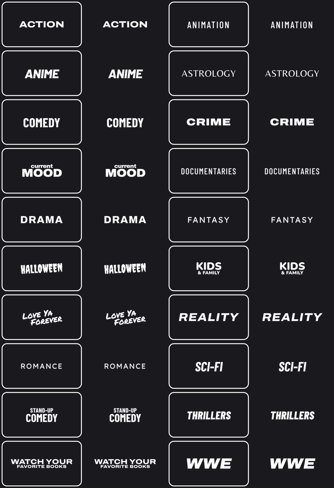

# Genre cards

Genre-kaartjes als transparante PNG's (1248×728). Elk genre heeft een gewone en een `-focused` versie (witte rand).

`https://raw.githubusercontent.com/VeranuVW/genre-cards/main/blue/<naam>.png`

## Zonder achtergrond

Dezelfde kaartjes met alleen witte tekst op transparant staan in `transparent/`:
`https://raw.githubusercontent.com/VeranuVW/genre-cards/main/transparent/<naam>.png`

Opnieuw genereren of genres toevoegen: zie `src/make_cards.js` (`PLAIN=1 node make_cards.js` voor de versie zonder achtergrond).
